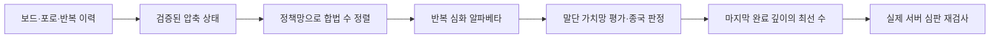

# Lab Neural Alpha-beta 모델 안내

선정 후보: **`lab-neural-v2`**. 실제 성과는 [실험 기록](WINRATE_RESULTS.md)을 따른다.

## 구성

원본 AlphaZero v2의 학습 가중치를 보존하고, 정책망으로 수를 정렬한 뒤 가치망을 말단 평가로 사용하는 반복 심화 알파베타를 구현했다. 새 가중치를 학습하거나 원본 모델을 수정하지 않았다.



각 완료 깊이에서 합법 수 전체를 후보로 삼고, 알파베타 경계로 결과에 영향을 주지 않는 가지를 생략한다. 낮은 정책 점수만으로 수를 제외하지 않는다. 말단은 학습된 휴리스틱이므로 제한 깊이의 값이 정확한 게임 승패라는 뜻은 아니다.

| 항목 | 원본 `azero-v2` | 새 후보 |
| --- | --- | --- |
| 가중치 | `azero-v2.bin` | 같은 파일 |
| 탐색 | PUCT 800회 | 정책 정렬 + 알파베타 |
| 계산 한도 | 800회 | 최대 2초 / 16,000개 자식 상태 / 깊이 10 |
| 무승부의 탐색 효용 | 0 | 루트 관점 -0.1 |
| 실제 무승부 집계 | 무승부 | 같은 무승부 |
| 재사용 | 호출 내 탐색 트리 | 호출 내 정적 신경망 출력 캐시 |

원본 등록 설정 대전이므로 계산량이 같은 순수 알고리즘 비교는 아니다. 원본과 행동이 같은 통제 대전과 탐색량만 늘린 후보도 별도로 확인했다.

## 이력과 효용

`historyFromEngine`으로 전체 국면 등장 횟수를 복원한다. 탐색 자식에 들어갈 때 횟수를 증가시키고 `finally`에서 복원하므로 시간/노드 중단도 이력을 오염시키지 않는다. 실제 규칙과 전이는 검증된 `azero-core.mjs`의 `legal/step/verdict`를 사용한다.

캐시 키는 현재 국면과 그 국면의 등장 횟수다. 가치망 입력에 해당하는 정적 출력만 재사용하고, 서로 다른 과거 이력의 탐색 점수·승패를 보드 키 하나로 합치지 않는다. 이전 최선 수의 보드별 저장은 정렬에만 사용한다.

가치망 출력은 내부 척도 10,000, 확정 종국은 약 ±1,000,000이다. 무승부 선호는 승리 기회를 더 찾으려는 탐색 효용이며 상대 차례에서는 부호를 뒤집는다. 공식 반복 무승부나 256수 배치를 승패로 바꾸지 않는다. 내부 점수는 실제 승률로 표시하지 않는다.

새 후보는 사람 대국에 전체 256수 한도를 추가하지 않는다. 웹 배치 256수 제한은 기존 심판이 적용한다. 원본 가치망의 256수 이후 기력은 별도 검증 대상이다.

## 계약과 버전

진입점은 `models/lab-neural-v2.mjs`의 named export `think(request)`다. `action`과 기존 규격의 `info.nodes/completedDepth/searchMs`를 반환한다.

| config | 값 |
| --- | ---: |
| `maxDepth` | 10 |
| `maxNodes` | 16000 |
| `maxTimeMs` | 2000 |
| `cacheEntries` | 3000 |
| `drawBias` | 0.1 |

`nodes`는 중복을 포함해 생성한 탐색 자식 상태 수다. `completedDepth`는 완료한 균일 미니맥스 깊이다. 중단 시 진행 중 깊이의 부분 결과를 사용하지 않는다. 깊이 1도 끝내지 못하면 정책망이 우선한 합법 수를 반환한다. 즉시 종국 승리는 먼저 확인한다.

시간은 부드러운 상한이므로 평가·GC·스케줄링으로 조금 넘을 수 있다. 60초 제한과 실제 착수시간은 기존 실행기가 관리한다. 동일 입력이라도 완료 깊이가 달라지면 수가 달라질 수 있어 선별 4국과 실제 웹 100국 결과를 분리한다.

진입점 외 선언 파일은 `lab-neural-search-v1.mjs`, `azero-core.mjs`, `azero-v2.bin`이다. 외부 패키지·네트워크·외부 프로세스를 사용하지 않으며 실제 permission Worker와 128MiB 한도에서 검증했다. 입력 배열과 이력을 수정하지 않는다.

최종 검증에 고정한 artifact SHA-256:

`5fc3de8a94fc6237031e608f1cbbfbecbd68cb8f61f84cd2d05643629fb809f7`

코드·설정·공유 helper 변경은 새 파일과 ID/version으로 등록한다. v1~v4가 같은 helper를 사용하므로 과거 helper를 고쳐 모든 버전의 행동을 동시에 바꾸지 않는다.

## 검증과 재현

심판 엔진의 독립 깊이 3 트리와 선택 값·행동 일치, 캐시 유무, 반복 무승부 효용, 실제 permission Worker·양쪽 선공·입력 보존을 검사했다. 실제 대국은 모든 수와 최종 국면을 다시 재생해 확인한다.

```powershell
node --test tests/winrate-neural.test.js
node scripts/winrate-campaign.mjs --stage neural-search --b azero-v2 --games 4
node scripts/winrate-web.mjs lab-neural-v2 azero-v2 final-confirmation
```

같은 stage/label은 완료한 결과를 재사용하거나 기존 배치를 재개·재검증한다. 새 대국에는 새 이름을 사용한다. CLI 결과를 기존 웹 조합에 합산하지 않는다.

성능 해석은 고정 상대·시작 조건·예산·장비로 한정한다. 같은 네 초기 조건의 반복을 독립 표본 100개로 취급하지 않는다. 조정에 사용하지 않은 합법 오프닝과 다른 상위 상대를 따로 점검한다. 원본 출처는 `temp@f6f6a080fa205f49a6f5644b36554d9bd2e255bd`의 `AZERO_MODEL.md`, `azero-core.mjs`, `azero-v2.bin`이다.
